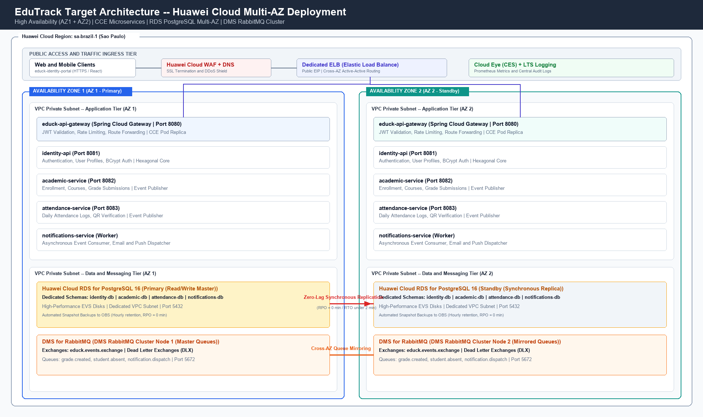

# Architecture design note — EduTrack

## 1. Target architecture

The target architecture redesigns the EduTrack educational management platform for deployment on Huawei Cloud, establishing an enterprise-grade, highly available, distributed microservices topology distributed across two Availability Zones (AZ1 and AZ2) within the South America region (sa-brazil-1). EduTrack is fundamentally structured as a domain-driven, event-decoupled system comprising core educational bounded contexts: identity management, academic evaluation, attendance tracking, and asynchronous multi-channel notifications. 

Incoming public traffic originating from student, teacher, and administrative clients interacting with the web portal (`educk-identity-portal`) traverses Huawei Cloud DNS and the Cloud Web Application Firewall (WAF) to perform threat inspection, SQL injection mitigation, and SSL/TLS 1.3 termination. Traffic is subsequently routed to a Dedicated Elastic Load Balancer (ELB) assigned a Public Elastic IP (EIP). The ELB acts as the cross-zone ingress gateway, dynamically distributing HTTPS traffic in an active-active configuration across the application subnets of AZ1 and AZ2.

Within the private Virtual Private Cloud (VPC `192.168.0.0/16`), the application tier is hosted on Huawei Cloud Container Engine (CCE), running Kubernetes-managed container workloads. Each microservice is containerized and deployed as resilient pod replicas scheduled evenly across both availability zones. The `educk-api-gateway` (Spring Cloud Gateway) intercepts all client requests, validates stateless JSON Web Tokens (JWT) issued by `identity-api`, applies cryptographic signature verification, enforces endpoint rate limiting, and securely routes requests to internal downstream microservices over private VPC interfaces.

Domain microservices (`academic-service`, `attendance-service`, and `identity-api`) publish business events such as student evaluation grades and attendance status updates directly to a managed Distributed Message Service (DMS) for RabbitMQ cluster. The `notifications-service` worker operates as a consumer, pulling messages from durable queues and dispatching email or push notifications without introducing synchronous runtime coupling. The persistence tier relies on Huawei Cloud Relational Database Service (RDS) for PostgreSQL deployed in an Active-Standby multi-AZ configuration, ensuring instantaneous synchronous replication and zero data loss. Centralized telemetry, container metrics, and application audit logs are continuously streamed to Cloud Eye (CES) and Log Tank Service (LTS).

| Component in the diagram | Defined in (file of your team's -docs) |
|---|---|
| educk-identity-portal | 05-architecture/decisions/records/ADR-005-frontend-microfrontends.md |
| educk-api-gateway | 05-architecture/decisions/records/ADR-006-api-gateway-jwt.md |
| identity-api | 05-architecture/overview.md |
| academic-service | 05-architecture/overview.md |
| attendance-service | 05-architecture/overview.md |
| notifications-service | 05-architecture/decisions/records/ADR-009-worker-http-polling.md |
| DMS RabbitMQ Cluster | 05-architecture/decisions/records/ADR-004-message-broker.md |
| RDS for PostgreSQL Multi-AZ | 05-architecture/decisions/records/ADR-003-database-per-service.md |
| Database Schemas (Data Models) | 06-data/models.md |
| Security Boundary and WAF | 05-architecture/security/stride-XimenaChala.md |

## 2. Five principles

| Principle | Current weakness | Evidence in -docs | Design decision | Huawei Cloud service |
|---|---|---|---|---|
| Reliability | Single point of failure in relational database storage; a compute crash or hypervisor failure halts all educational services without automated database failover. | 05-architecture/decisions/records/ADR-003-database-per-service.md | Deploy active-standby relational database across dual availability zones with zero-lag synchronous write-ahead log replication and automatic virtual IP failover. | Relational Database Service (RDS for PostgreSQL) Multi-AZ |
| Security | Public perimeter lacks managed Layer 7 application inspection, exposing authentication endpoints and API routes to credential stuffing and distributed denial-of-service. | 05-architecture/security/stride-XimenaChala.md | Place ingress traffic behind a managed web application firewall, enforce strict TLS 1.3 termination, and restrict backend microservice subnets to non-routable private CIDR blocks. | Web Application Firewall (WAF) & Dedicated ELB |
| Performance efficiency | Synchronous processing of heavy notification workflows (email and push dispatching) during mass grade submissions creates thread pool starvation and degrades API response times. | 05-architecture/decisions/records/ADR-004-message-broker.md | Decouple transaction lifecycles using persistent message exchanges with dedicated consumer workers, mirrored cluster queues, and dead-letter routing. | Distributed Message Service (DMS for RabbitMQ) |
| Cost | Statically provisioned virtual machines maintain peak-capacity resource allocations during nighttime, weekend, and school vacation lulls, wasting financial resources. | 05-architecture/overview.md | Adopt elastic container orchestration with horizontal autoscaling that dynamically scales down pod replicas to off-peak baselines and scales out on demand. | Cloud Container Engine (CCE) & Auto Scaling (AS) |
| Operations | Microservice logs are stored locally within ephemeral container file systems, impeding centralized distributed tracing, log aggregation, and real-time incident diagnosis. | 05-architecture/pattern-guide.md | Stream all stdout and stderr application logs, audit events, and JVM health telemetry into a unified cloud logging ingestion engine with automated threshold alarms. | Log Tank Service (LTS) & Cloud Eye (CES) |

## 3. Scalability

EduTrack experiences highly variable traffic patterns characterized by severe diurnal load spikes during school morning check-ins and end-of-term grading cycles, contrasted with minimal utilization during off-hours. To guarantee performance stability without overspending, horizontal pod autoscaling policies are applied directly to microservices managed by Cloud Container Engine (CCE). Scalability policies are defined for the primary traffic-handling components:

| Service | Scaling metric | Threshold (number and unit) | Min instances | Max instances |
|---|---|---|---|---|
| educk-api-gateway | Average CPU Utilization | 70 % | 2 | 8 |
| academic-service | HTTP Request Count Rate | 300 req/s | 2 | 6 |
| attendance-service | Average Memory Utilization | 75 % | 2 | 6 |

The `educk-api-gateway` operates as the unified ingress boundary for all incoming school interactions. Baseline availability mandates a minimum of two pod instances distributed across AZ1 and AZ2. The auto-scaling rule continuously samples container CPU utilization via the Kubernetes Metrics Server and Cloud Eye agent; when average CPU utilization exceeds the 70 % threshold over three consecutive 30-second evaluation intervals, the CCE cluster initiates scale-out actions by spawning additional gateway replicas up to a maximum limit of eight instances. A cool-down stabilization window of 300 seconds prevents thrashing during sudden load drops.

The `academic-service` handles grade publication, course registrations, and report card generation. During quarterly evaluation deadlines, thousands of concurrent instructors record grade rosters simultaneously. Scaling is driven by request throughput: whenever the incoming request volume exceeds 300 requests per second per pod, CCE adds instances up to a ceiling of six replicas. Database connection pooling is carefully tuned using HikariCP to ensure that scaling to six microservice replicas does not overwhelm PostgreSQL backend connection pools.

The `attendance-service` encounters rapid burst traffic specifically between 06:45 AM and 07:30 AM as thousands of students record their daily classroom attendance. Memory utilization serves as the primary scaling trigger; because attendance verification loads in-memory validation caches and classroom student rosters, crossing 75 % average memory consumption triggers the provisioning of supplementary replicas (up to six instances), guaranteeing sub-100-millisecond response latencies.

## 4. Disaster recovery

- Critical data store: EduTrack Academic and Identity Database Cluster (`identity-db`, `academic-db`, `attendance-db`, and `notifications-db` schemas) hosted on Huawei Cloud RDS for PostgreSQL.
- RTO: 2 minutes
- RPO: 0 minutes
- DR pattern (chapter 11): Active-Standby Cross-AZ Dual-Center High Availability Pattern.
- Why the pattern meets those numbers: The active-standby cross-AZ deployment enforces synchronous write-ahead log (WAL) replication across isolated physical availability zones, ensuring every committed transaction is durably written to both storage engines before returning success, which mathematically guarantees an RPO of 0 minutes. If the primary database instance experiences a catastrophic hardware failure, the automated cluster arbiter detects heartbeat loss, promotes the standby instance in AZ2 to primary, and redirects the virtual IP address (VIP) within 120 seconds, successfully achieving an RTO under 2 minutes.

In addition to the synchronous cross-AZ high availability pattern, EduTrack institutes automated daily and hourly database snapshots transmitted directly to Huawei Cloud Object Storage Service (OBS). OBS guarantees 99.999999999 % (11 nines) data durability with automated cross-region asynchronous replication to a secondary disaster recovery region (la-south-2). While the cross-AZ active-standby topology shields the platform from local physical facility outages and data corruption events without data loss, the decoupled snapshot tier ensures rapid restore capability against accidental administrative data deletion or ransomware threats.

## 5. Automated deployment

The EduTrack deployment lifecycle implements continuous integration, security auditing, and automated container deployment across our multi-branch Git workflow (`develop`, `qa`, and `main` / `release.2.x.x`). The pipeline ensures that every code change is validated through automated testing, verified against architectural security policies, and deployed to target cloud environments without service disruption.

| Stage | Trigger | Tool or service | File in your team's repositories |
|---|---|---|---|
| Build | Git push to feature branch or pull request creation | GitHub Actions / Maven 3.9 & Java 21 | .github/workflows/ci.yml |
| Test | Successful completion of application build | JUnit 5, Mockito & Maven Surefire | pom.xml |
| Image | Merge of pull request into develop or qa branch | Docker Buildx & SoftWare Repository for Container (SWR) | Dockerfile |
| Deploy to qa | Push of commit to qa branch via cherry-pick | CCE Continuous Deployment Pipeline / kubectl | .github/workflows/deploy-qa.yml |
| Deploy to production | Release tag creation or authorized PR merge to main | Huawei Cloud CodeArts Deploy / Rolling Update | .github/workflows/deploy-prod.yml |
| Rollback | Automated health check probe failure (readiness/liveness) | Kubernetes CCE Rolling Update Rollback & Helm | k8s/deployment.yaml |

The pipeline begins with the **Build** stage, triggered upon any push to a feature branch (`hu-*-dev`). The Maven wrapper compiles the Java 21 codebase, resolves project dependencies, and verifies syntax integrity. In the **Test** stage, unit tests and architectural boundary tests execute automatically via Maven Surefire; test execution includes negative authorization validation (such as `IdentityAuthorizationNegativeTest.java`) ensuring role-based access controls cannot be circumvented. 

Upon successful testing, the **Image** stage constructs multi-stage, hardened Docker container images utilizing distroless base runtimes to eliminate unneeded OS utilities. Built images are scanned for vulnerabilities and pushed to Huawei Cloud SoftWare Repository for Container (SWR) with immutable semantic version tags. In the **Deploy to qa** stage, staging environments deployed on dedicated CCE namespaces are updated automatically, executing integration tests and database migration scripts managed by Flyway. 

For **Deploy to production**, releases follow an automated rolling update strategy across the dual-AZ CCE cluster. Pods are updated incrementally with a zero-downtime surge policy (`maxSurge: 25%`, `maxUnavailable: 0`), verifying that new instances pass HTTP readiness probes before old instances are terminated. Finally, the **Rollback** stage continuously monitors Kubernetes liveness probes and Cloud Eye error rates; if a newly deployed version registers HTTP 5xx error spikes or fails startup health checks within three minutes, CCE executes an automated `rollout undo`, instantaneously reverting traffic to the preceding stable revision.

## 6. Decisions

- [ADR-C3-01](ADR-C3-01.md): Adoption of Cross-AZ Active-Standby RDS for PostgreSQL for High Availability and Zero-Data-Loss Disaster Recovery.
- [ADR-C3-02](ADR-C3-02.md): Deployment of EduTrack Backend Microservices on Cloud Container Engine (CCE) with Dynamic Horizontal Auto Scaling.
